# 🚀 Kanban Pro

[](https://github.com/JoaoTech-hub/kanban-pro/actions/workflows/ci.yml)
[](./LICENSE)

Plataforma SaaS multi-tenant de gerenciamento de tarefas no estilo Kanban, com organizações, projetos, controle de acesso por papel (owner/admin/member), autenticação com revogação de sessão e recuperação de senha por e-mail. Construído como base reutilizável para futuros produtos SaaS.

 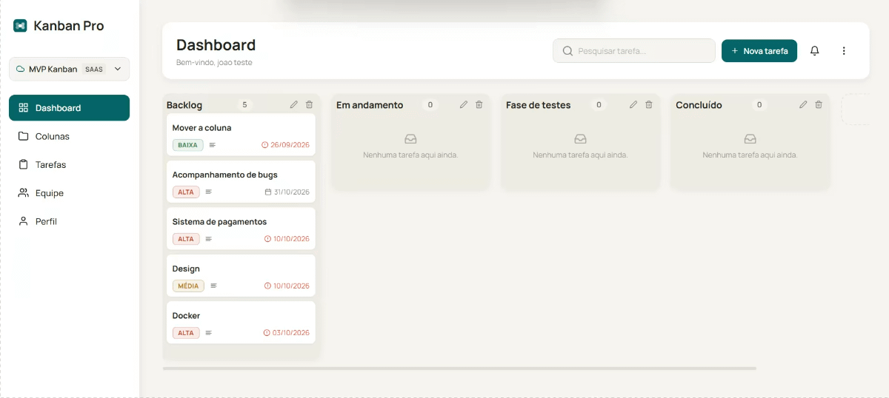

## ✨ Funcionalidades

- Multi-tenancy: cada conta pertence a uma ou mais organizações, com dados totalmente isolados entre elas
- Controle de acesso por papel (`owner`, `admin`, `member`) — apenas owner/admin gerenciam projetos, colunas e cards
- Autenticação com JWT, revogação de sessão (tokens antigos invalidados automaticamente após troca de senha)
- Recuperação de senha por e-mail, com token de uso único e expiração curta
- Projetos, colunas e cards totalmente customizáveis, com drag-and-drop entre colunas
- Prioridade, prazo e descrição por tarefa
- Página de Tarefas com busca e filtros (prioridade / coluna)
- Página de Projetos com progresso visual por coluna
- Edição de perfil (nome e senha)
- Tema claro/escuro persistido
- Notificações visuais (toasts) para ações de criar/renomear/excluir
- Estados vazios tratados (colunas e listas sem itens nunca parecem "quebradas")
- Layout responsivo, com menu lateral retrátil no mobile
- Code-splitting por rota, com carregamento sob demanda das páginas

## 📸 Screenshots

### 📊 Dashboard

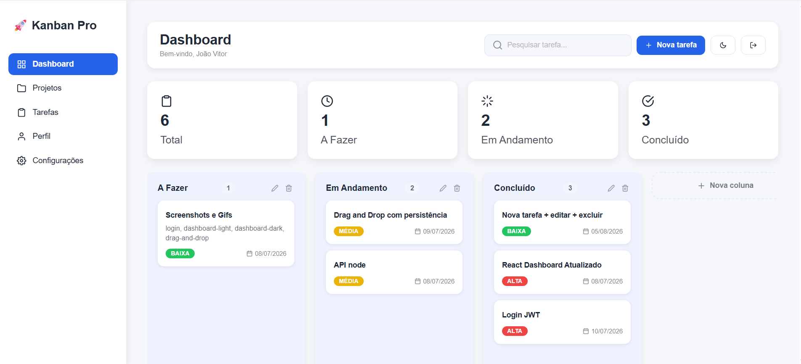

---

### 🌙 Dashboard (Tema Escuro)

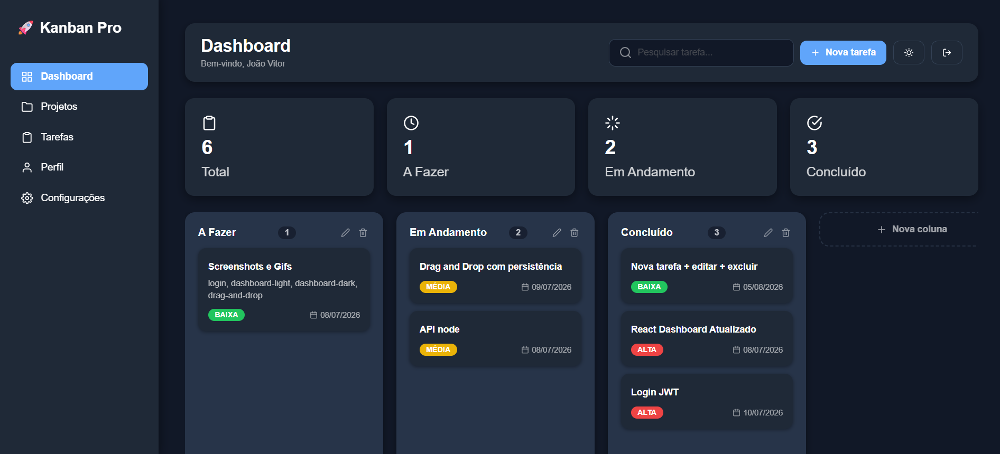

---

### 📁 Gerenciamento de Colunas

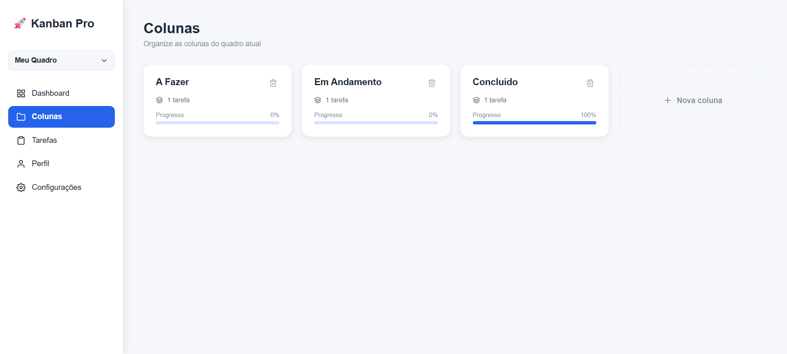

Cada organização pode ter um ou mais quadros (a entidade `Project`, no backend); esta tela gerencia as colunas do quadro ativo no momento. Para criar, trocar ou excluir quadros, use o seletor no topo do menu lateral.

### ✅ Gerenciamento de Tarefas

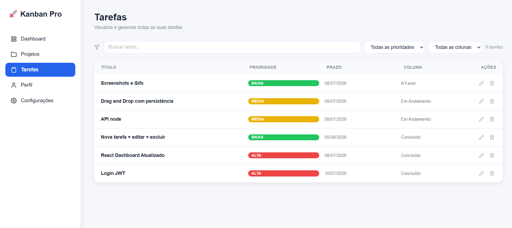

---

### 👤 Perfil

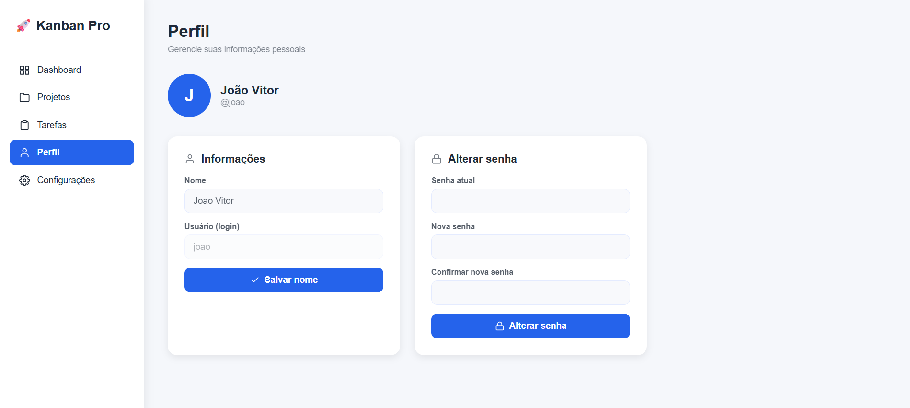

---

### ⚙️ Configurações

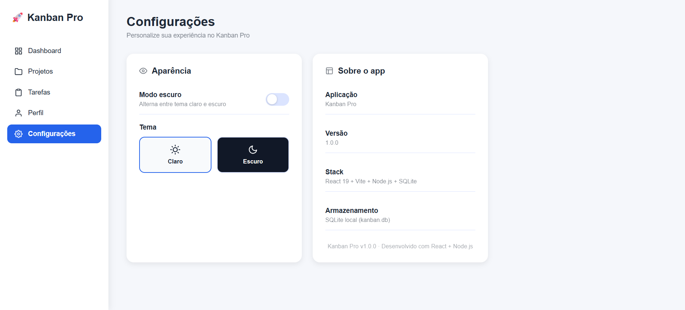

---

### ➕ Nova Tarefa

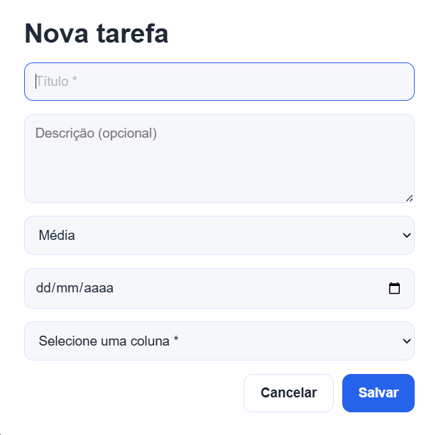

---

### 🔐 Login

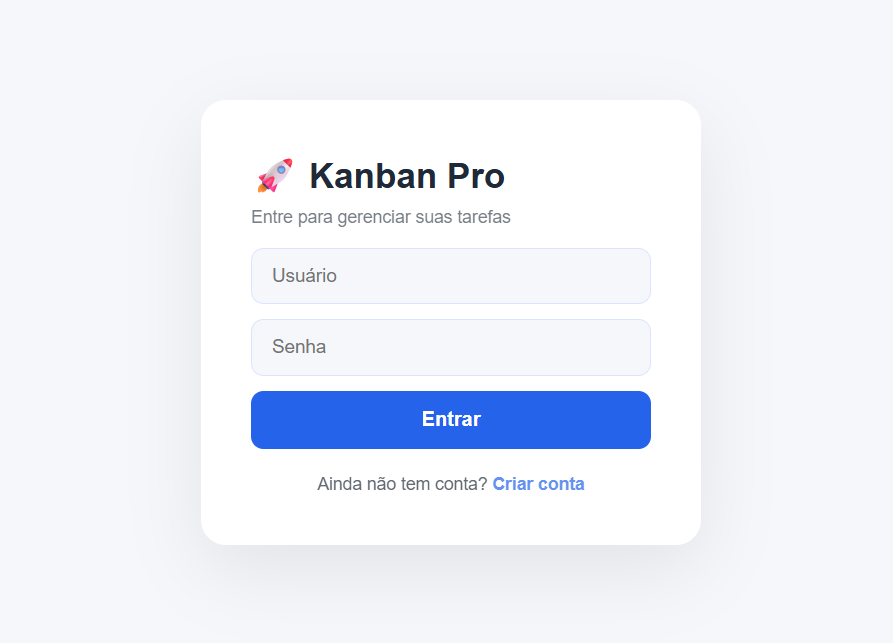

---

### 📝 Cadastro

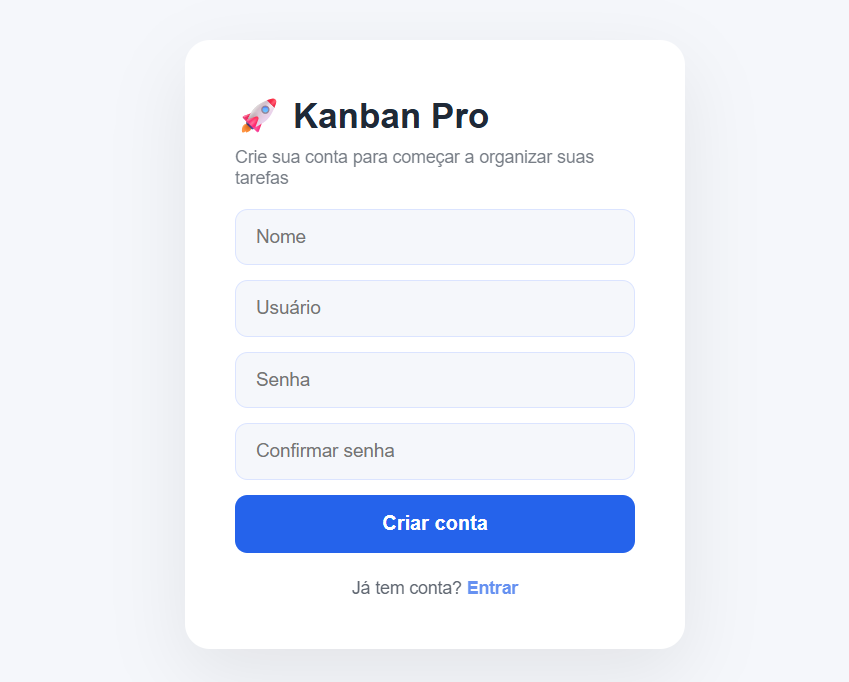

---

### 📱 Versão Mobile

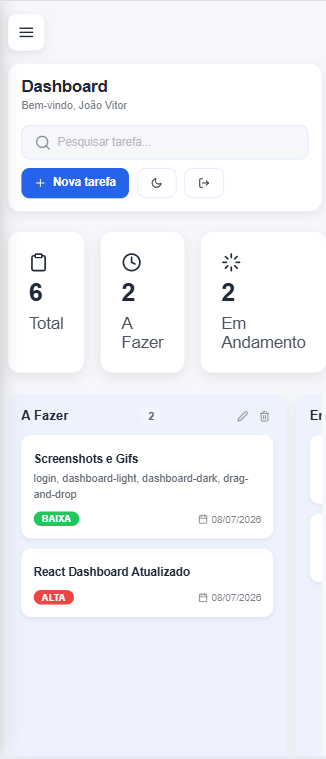

## 🛠️ Stack

**Frontend:** React 19, Vite, React Router, styled-components, @hello-pangea/dnd, Axios
**Backend:** Node.js, Express 5, PostgreSQL (Neon), Prisma ORM, JWT, bcrypt, Zod (validação), Helmet, express-rate-limit, Resend (e-mail transacional)
**Testes:** Vitest + Testing Library (frontend), Jest + Supertest (backend)
**CI:** GitHub Actions (lint, testes e build a cada push/PR)

## 🏗️ Arquitetura

```text
┌──────────────┐        HTTPS/JSON        ┌──────────────────┐
│   Frontend   │ ───────────────────────▶ │      Backend      │
│  React (SPA) │ ◀─────────────────────── │  Express (REST)   │
└──────────────┘        JWT Bearer        └──────────────────┘
                                                     │
                                                     ▼
                                          ┌──────────────────┐
                                          │ PostgreSQL (Neon)│
                                          │  via Prisma ORM  │
                                          └──────────────────┘
```

Modelo de dados multi-tenant: `Organization` → `Project` → `Coluna` → `Card`, com `organizationId` presente em toda tabela filha — nenhuma consulta busca um recurso só pelo próprio `id`, sempre em conjunto com a organização (e, quando aplicável, o projeto) do usuário autenticado.

O backend segue arquitetura em camadas, para manter regra de negócio, acesso a dados e transporte HTTP desacoplados:

routes → validators (Zod) → controllers → services → repositories → Prisma
│
middlewares (auth, requireOrganization, requireProject, error handler)

- **routes/** define os endpoints e aplica os middlewares (autenticação, escopo de organização/projeto, rate limit).

- **validators/** valida e normaliza o corpo da requisição com Zod antes de chegar ao controller.

- **controllers/** só traduz HTTP ↔ service — não conhece Prisma, não tem regra de negócio.

- **services/** contém a regra de negócio (autorização por papel, transações, orquestração entre repositories).

- **repositories/** encapsula todo acesso ao Prisma — nenhum outro arquivo importa o client diretamente.

- **middlewares/** cuida de autenticação (JWT), resolução de organização/projeto ativos, e centraliza o tratamento de erros.

- **services/email/** isola o envio de e-mail atrás de uma abstração própria (ver seção [Provedores de e-mail](#-provedores-de-e-mail)).

No frontend, a lógica de comunicação com a API fica isolada em hooks customizados (`useKanban`, `useColunas`, `useProjetoAtivo`), mantendo os componentes de UI focados em apresentação. Estado global de autenticação (incluindo organização ativa) e tema fica em Context API (`AuthContext`, `ThemeContext`, `ToastContext`).

## 🧠 Decisões técnicas

- **Multi-tenancy via shared schema**: todas as organizações dividem o mesmo banco e as mesmas tabelas, isoladas por `organizationId`. Mais simples de operar com custo zero do que um banco por tenant, e é o padrão usado pela maioria dos SaaS neste estágio de maturidade.

- **PostgreSQL (Neon) + Prisma em vez de SQLite**: viabiliza múltiplas conexões concorrentes reais (necessário assim que existe mais de um usuário simultâneo) e migrations versionadas, sem exigir um servidor de banco próprio — o free tier do Neon cobre a fase atual do produto.

- **Revogação de sessão via `tokenVersion`**: em vez de refresh tokens (mais complexo de implementar corretamente), cada usuário tem um contador incrementado a cada troca de senha; o middleware de autenticação compara essa versão a cada requisição, invalidando tokens antigos sem esperar a expiração natural.

- **Recuperação de senha com token de uso único**: o token enviado por e-mail nunca é guardado em texto puro no banco (só o hash SHA-256), expira em 1 hora, e é invalidado automaticamente após o uso ou ao solicitar um novo.

- **Abstração de e-mail (`emailService`)**: nenhuma parte do domínio (services de auth, etc.) conhece qual provedor de e-mail está em uso — troca de provedor não exige mudar código de negócio (ver seção dedicada abaixo).

- **Validação com Zod no backend**: garante que dados inválidos nunca cheguem aos services, independentemente do que o frontend envie — o backend nunca confia apenas na validação do cliente.

- **Autorização por papel (`owner`/`admin`/`member`)**: operações de escrita em projetos, colunas e cards exigem papel gerencial; leitura é liberada para qualquer membro da organização.

- **React.lazy por rota**: como o dashboard (com drag-and-drop) é a tela mais pesada, mas nem toda sessão a acessa imediatamente, dividir o bundle por rota reduz o JS carregado no primeiro acesso (tela de login).

## 📁 Estrutura do projeto

Kanban-Pro/
├── backend/
│   ├── prisma/
│   │   ├── schema.prisma   # modelo de dados (multi-tenant)
│   │   └── migrations/     # histórico de migrations versionadas
│   ├── src/
│   │   ├── config/         # conexão Prisma, validação de variáveis de ambiente
│   │   ├── controllers/    # tradução HTTP ↔ service
│   │   ├── services/       # regra de negócio
│   │   │   └── email/      # abstração de envio de e-mail (provider-agnostic)
│   │   ├── repositories/   # todo acesso ao Prisma fica aqui
│   │   ├── middlewares/    # autenticação, escopo de organização/projeto, erros
│   │   ├── routes/         # definição dos endpoints
│   │   ├── validators/     # schemas de validação (Zod)
│   │   ├── shared/         # erros de domínio, helpers de autorização
│   │   └── app.js          # montagem do Express
│   ├── tests/               # testes de integração (Jest + Supertest)
│   └── server.js            # ponto de entrada
└── frontend/
└── src/
├── components/     # componentes reutilizáveis
├── context/        # AuthContext, ThemeContext, ToastContext
├── hooks/          # useKanban, useColunas, useProjetoAtivo
├── pages/          # telas da aplicação (carregadas via React.lazy)
├── services/       # cliente Axios
├── styles/         # styled-components e tema
└── tests/          # testes (Vitest + Testing Library)

## ▶️ Como rodar localmente

Pré-requisitos: Node.js 20+, uma conta gratuita no [Neon](https://neon.tech) (Postgres).

### 1. Clonar o repositório

```bash
git clone https://github.com/JoaoTech-hub/kanban-pro.git
cd kanban-pro
```

### 2. Backend

```bash
cd backend
npm install
cp .env.example .env
```

Crie um projeto no Neon e obtenha duas connection strings (uma com connection pooling ligado, outra desligado — veja `.env.example` para o formato exato). Gere um `JWT_SECRET` forte:

```bash
node -e "console.log(require('crypto').randomBytes(64).toString('hex'))"
```

Preencha `DATABASE_URL`, `DIRECT_URL` e `JWT_SECRET` no `.env`. Depois, aplique as migrations e suba o servidor:

```bash
npx prisma migrate deploy
npm run dev
```

A API sobe em `http://localhost:3000`.

### 3. Frontend

Em outro terminal:

```bash
cd frontend
npm install
cp .env.example .env
npm run dev
```

O app sobe em `http://localhost:5173`. Crie uma conta pela tela de registro e comece a usar.

## ✅ Rodando os testes

```bash
# backend (usa um banco Postgres de teste separado — veja .env.example)
cd backend && npm test

# frontend
cd frontend && npm test
```

## 🔐 Variáveis de ambiente

**backend/.env**
| Variável | Obrigatória | Descrição |
|---|---|---|
| `DATABASE_URL` | Sim | Connection string do Postgres (Neon), com connection pooling — usada em runtime |
| `DIRECT_URL` | Sim | Connection string direta (sem pooling) — usada só pelo Prisma Migrate |
| `JWT_SECRET` | Sim | Segredo usado para assinar os tokens JWT. Gere um valor aleatório forte (32+ caracteres), nunca use um texto fixo |
| `NODE_ENV` | Não (padrão: `development`) | `development`, `test` ou `production` |
| `PORT` | Não (padrão: `3000`) | Porta em que a API roda |
| `FRONTEND_URL` | Sim em produção | Origem(ns) permitida(s) pelo CORS, separadas por vírgula se houver mais de uma |
| `EMAIL_PROVIDER` | Não (padrão: `resend`) | Provedor de e-mail em uso — ver seção [Provedores de e-mail](#-provedores-de-e-mail) |
| `RESEND_API_KEY` | Sim, se usar Resend | Chave de API gerada em resend.com |
| `EMAIL_FROM` | Sim, se usar Resend | E-mail remetente (ex: `"Kanban Pro <no-reply@seudominio.com>"`) |

**frontend/.env**
| Variável | Descrição |
|---|---|
| `VITE_API_URL` | URL base da API (ex: `http://localhost:3000` em desenvolvimento) |

## 📧 Provedores de e-mail

O envio de e-mails (recuperação de senha, e futuros avisos) passa por uma camada de abstração em `backend/src/services/email/`. Nenhuma outra parte do backend conhece qual provedor está em uso — o único ponto de contato é `emailService.enviarResetSenha(...)`.

backend/src/services/email/
├── emailService.js          # abstração central — o resto do app só fala com ela
├── providers/
│   └── resendProvider.js    # implementação concreta (Resend)
└── templates/
└── resetSenha.js        # HTML do e-mail, separado da lógica de envio

### Trocar de provedor

1. Crie um arquivo novo em `providers/`, seguindo o mesmo contrato do `resendProvider.js`:
```js
   async function enviar({ to, subject, html }) {
     // lógica específica do novo provedor aqui
   }
   module.exports = { enviar };
```
2. Registre o novo provider no objeto `PROVIDERS` de `emailService.js`.
3. Instale o SDK do provedor (`npm install sendgrid`, `npm install @aws-sdk/client-ses`, etc.).
4. Ajuste `EMAIL_PROVIDER` no `.env` para o nome que você registrou (ex: `EMAIL_PROVIDER=sendgrid`).
5. Adicione as variáveis de ambiente que esse provedor precisar ao `.env` e ao `.env.example`.

Nenhum outro arquivo do projeto precisa mudar — nem os services que disparam e-mail, nem os controllers, nem os testes (que já simulam o `emailService` inteiro via `jest.mock`, sem depender de nenhum provedor real).

## 🗺️ Roadmap

- [x] Multi-tenancy (organizações, projetos, isolamento de dados)
- [x] Controle de acesso por papel (owner/admin/member)
- [x] Revogação de sessão após troca de senha
- [x] Recuperação de senha por e-mail (backend + frontend)
- [x] Múltiplos quadros por organização (criar, trocar, excluir — respeitando o limite do plano)
- [ ] Deploy público (Vercel + Render/Railway)
- [ ] Convite de membros para uma organização
- [ ] Paginação em listagens de projetos/colunas/cards
- [ ] Documentação da API (OpenAPI/Swagger)

## 📄 Licença

Este projeto está sob a licença MIT — veja o arquivo [LICENSE](./LICENSE) para mais detalhes.

---

Desenvolvido por **João Vitor** — [GitHub](https://github.com/JoaoTech-hub)